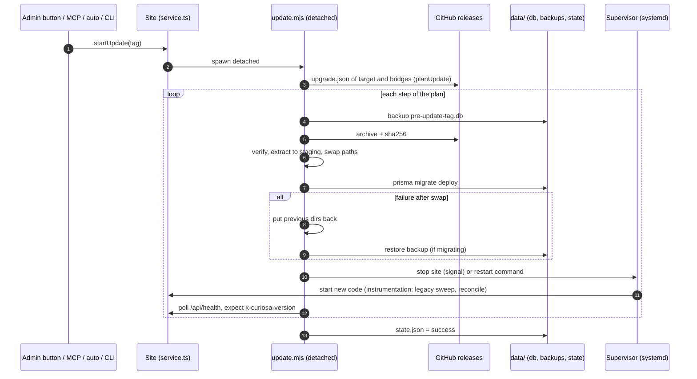

# Update paths: bare metal vs Docker

Status: design proposal, no code. Written against core 0.6.12 (`dev` aligned with `master`).
Goal: make Docker a first-class install (prebuilt multi-arch image on GHCR at every release, guided install script, NAS users) **without a second update system to maintain**.

Reading guide: section 1 is the as-is inventory (from the code), section 2 the matrix, section 3 the design, section 4 the maintenance checklist, section 5 the recommendation and the decisions needed.

## 1. As-is inventory

### 1.1 Bare metal (the release archive path)

**Install** (`scripts/install.sh`, published as a release asset next to the archive):
1. Detects the host, asks at most three questions (site name, domain, Linux user), installs Node 22, git, Caddy/nginx/Apache config as needed.
2. `download_release`: downloads `curiosa-vX.Y.Z-linux-x64.tar.gz` and its `.sha256`, verifies the hash, rejects unsafe paths, checks that `release.json`, `node_modules` and `prisma` are present.
3. Unpacks to `/var/www/<site>`; creates the dedicated user; writes `.env` (`DATABASE_URL=file:../data/curiosa.db`, `SITE_URL`, `CURIOSA_SUPERVISED=1`, `CURIOSA_READY_URL`, `SETUP_TOKEN`); creates `data/`.
4. `migrate_db`: `node node_modules/prisma/build/index.js migrate deploy` as the site user.
5. Writes a systemd unit (`Restart=always`, `KillMode=control-group`, single `node ... next start` process), starts it, configures the proxy, verifies the public URL.

**Layout on disk**: code (`.next`, `node_modules`, `scripts`, `prisma/migrations`, `fonts`, `release.json`...) is replaced on update; **`data/` and `.env` are protected** (`PROTECTED` in `scripts/update-lib.mjs`). `data/` holds the SQLite file, uploads, `data/modules/<id>/` (installed modules, `MODULES_DIR`), the session secret, `data/backups/`, `data/update/{state.json,update.log}`.

**Release artifact** (`scripts/release-pack.mjs`, run by `.github/workflows/release.yml` on `ubuntu-latest`, linux-x64 only):
- Asset `curiosa-vX.Y.Z-<platform>.tar.gz` + `.sha256`, plus `upgrade.json` and `install.sh` as separate assets.
- Contents: `.next` (compiled, no `.next/cache`), pruned production `node_modules` (Prisma client generated with `binaryTargets` `native`, `debian-openssl-1.1.x`, `debian-openssl-3.0.x`; ~270 MB of unused files excluded, `NOT_SHIPPED`), `package.json`, `next.config.mjs`, `prisma/schema.prisma`, `prisma/migrations`, `scripts`, `fonts`, `.env.example`, licences, and `release.json` (`version`, `platform`, `repo`, `node`, `paths`, `languages`). **No `src/`, no modules, no `upgrade.json` inside the archive.**
- `scripts/smoke-release.mjs` boots the archive (fresh install, then an older database) before anything is published.
- Release cycle: push to `dev` = snapshot (never offered), `-rc.N` = rc channel only, merge to `master` = stable `vX.Y.Z`.

**Update, end to end** (`src/core/updates/service.ts` + `scripts/update.mjs` + `scripts/update-lib.mjs`):
- `getInstallInfo()`: mode `release` (has `release.json` and a repo) `canUpdate: true`; `docker` (env `CURIOSA_INSTALL=docker`) `canUpdate: false`; otherwise `manual`.
- `checkForUpdate()` (every 6 h via `scheduler.ts`, first run 5 minutes after start) lists GitHub releases, keeps the highest stable one that has this platform's archive, caches version and notes in settings. **It returns early when `canUpdate` is false.**
- Triggers: the admin Updates page (`updates/actions.ts` calls `startUpdate`), the MCP tool `maintenance_core_update` (level 3, creates an owner approval request; `findLatestStable` + `startUpdate(..., stableOnly)`; never rc, never downgrade), the auto-updater (`runScheduledCheck`, off by default, never a major version, never an rc), and the CLI `node scripts/update.mjs vX.Y.Z`.
- `startUpdate` spawns `scripts/update.mjs` **detached**, so it survives the server it is about to stop.
- `runUpdateChain`: `planUpdate()` reads `upgrade.json` of the target release (then of each bridge, at most 6 steps) and returns the tag list; then `runUpdate` per step.
- `runUpdate` per step: lock (`state.json`, stale after 1 h) → checks (`release.json` present, repo valid) → **pre-update database backup** (`data/backups/pre-update-<tag>-<ts>.db`, keeps 5) → download + `.sha256` → verify → tar listing check → extract to `.curiosa-staging` → validate `release.json` (version, platform, `paths`) → **swap** each path into place, old ones to `.curiosa-previous` → **`npx prisma migrate deploy`** → cleanup → restart → (non-last step or `confirmServer`) wait for the new server.
- **Rollback**: any failure after the swap moves the previous directories back; if migrations had started, the pre-update `.db` is restored over the live one; the old server is restarted to re-read it. State records `rolledBack`.
- **Restart modes** (`restart()` in `runUpdate`): `CURIOSA_RESTART_COMMAND` (runs the operator's command), `CURIOSA_SUPERVISED=1` (`stopSite` kills the whole site process group, verifies the port is free, the supervisor relaunches), neither (state `restart: "needed"`, the page asks for a manual restart).
- **Health wait** (`makeSiteWaiter` / `confirmNewServer` in `update-proc.mjs`): polls the ready URL (`/api/health`, which returns `ok` with an `x-curiosa-version` header carrying `hashVersion(version)`), so an old server still in memory is not mistaken for the new one. Timeouts scale with load (`CURIOSA_STOP_SECONDS`, `CURIOSA_PORT_SECONDS`, `CURIOSA_SITE_SECONDS`). If the updater is killed with the service (systemd control-group), `reconcileInterruptedUpdate()` runs at server start (`src/instrumentation.ts`) and concludes the state honestly from the running version.
- **Support floor and bridge** (`docs/MIGRATIONS.md`, `upgrade.json`, `src/core/updates/migrations-registry.json`): `upgrade.json` has `minFrom` (today `0.6.10`), published per release. A site below the floor is chained through bridge releases (`0.1.1` takes 4 steps today); each step restarts and waits, because **the first start of a bridge is what converts the data** (`register()` in `instrumentation.ts` runs `runLegacySweep`, which runs pending module `dataVersion` conversions). Conversions are update steps only, listed in the registry with `removableAtFloor`; `tests/core/migration-registry.test.mjs` and `tests/modules-mgmt/legacy-removal.test.mjs` enforce and simulate this.
- **Module data**: modules live in `data/modules/`, outside the archive paths, so a core update never touches them; their `dataVersion` migrations run at module install/update and in the start-up sweep (permanent contract, not core legacy).
- **Admin Updates page** (`src/app/admin/(panel)/updates/page.tsx`): current version, latest version and notes, channel (rc in advanced mode), auto-update switch, "Install" button with progress (`CoreUpdateProgress`), chain steps ("to follow / in progress / installed"), failure with rollback state and technical details (log tail), hosting warnings (`inspectHosting`: second process manager, npx unit), "restart needed" callout. When `canUpdate` is false it shows only the version and the message `updates.mode.<mode>`.



### 1.2 Docker today

- **Dockerfile**: multi-stage on `node:22-slim`. The `build` stage runs `npm ci` and `npm run build` from the **source tree** (`COPY . .`), the `run` stage copies the whole `/app` (dev dependencies, `src/`, caches included). Env: `NODE_ENV=production PORT=3000 DATA_DIR=/app/data DATABASE_URL=file:/app/data/curiosa.db CURIOSA_INSTALL=docker`. `VOLUME /app/data`. `CMD sh -c "npx prisma migrate deploy && npx next start"` (three processes via `npx`, migrations on **every** start, **no backup before them**).
- **docker-compose.yml**: `build: .` (no registry image), port 3000, volume `curiosa_data:/app/data`, `restart: unless-stopped`; `CURIOSA_SUPERVISED` is not set.
- **No `release.json` in the image**, and the build path (`npm run build` in Docker) is different from the CI path (`release-pack.mjs`): two build paths already exist.
- **What the in-admin updater does**: nothing. `getInstallInfo()` returns `docker`, `canUpdate: false`; the Updates page shows the current version and "update by replacing the image"; `startUpdate` returns `unsupported`; `maintenance_core_update` refuses with "container image"; `checkForUpdate` and `findLatestStable` return early. **Docker users are never told that a new version exists** (no check, no notes, no badge).
- **Where things live**: code in the image layer (`/app` minus `data`), everything operator-owned in the volume (`/app/data`: db, uploads, `modules/`, backups, auth secret, update state). Installed modules are in the volume, so they survive a recreation; the core code does not (it comes from the new image). `.env` is not used; configuration is container environment.
- **What survives recreation**: the whole volume. What does not: anything written to `/app` outside `data` (for example a `.next/cache`).
- **Update today**: manual `docker compose build --pull && docker compose up -d` (`docs/INSTALL.md`, README). The new container runs `prisma migrate deploy` then `next start`; the start-up sweep (`runLegacySweep`) runs as for bare metal. There is no backup, no health wait, no chain through bridges (a site below the floor jumps straight to the new code, which no longer carries the old conversions), no rollback.

```mermaid
sequenceDiagram
  autonumber
  participant O as Operator
  participant C as docker compose
  participant I as Image (built locally)
  participant V as Volume /app/data
  O->>C: build --pull (npm ci + next build from source)
  C->>I: new image
  O->>C: up -d
  C->>C: stop and remove old container
  C->>I: start new container
  I->>V: prisma migrate deploy (no backup)
  I->>V: next start; instrumentation legacy sweep
  Note over O,V: no health wait, no plan through bridges, no rollback
```

## 2. Matrix

"Shared" lists what already is (or must become) the same code in both columns.

| Concern | Bare metal today | Docker today | Docker target (image-based) | Shared code |
|---|---|---|---|---|
| Artifact | `curiosa-vX-linux-x64.tar.gz` built by CI (`release-pack.mjs`) | Image built from source on the operator's machine | Image built in the release workflow **from the same tarball**; one tarball per architecture | Tarball and `release.json` |
| Version source | `release.json` + `package.json`; releases listed from GitHub API | `package.json` only; nothing is checked | Same `release.json` inside the image; check via the same GitHub release list | `checkForUpdate`, `pickLatestRelease`, `getUpdateCheck` |
| Plan (steps for old sites) | `planUpdate` reads `upgrade.json` per release | None | **Same `planUpdate` output**, mapped to image tags | `planUpdate`, `upgrade.json` |
| How new code gets in | Download, verify sha256, extract, swap directories in place | Replace container with a new image | Pull image tag(s) and recreate the container | Verification of the same tarball (sha256 at image build, image digest at pull) |
| Backup before migration | `data/backups/pre-update-<tag>-<ts>.db` (keep 5) | None | Same file, same retention, made at container start when the data version is older than the code | One `backupDatabase()` extracted from `runUpdate` |
| DB migrations | `prisma migrate deploy` in `runUpdate`; install.sh does it too | `prisma migrate deploy` in `CMD` at every start | Same call, same executor, at container start | One `applyMigrations()` |
| Module data migrations | `dataVersion` run by the start-up sweep and the module install/update flow | Same, at start | Same | `runLegacySweep`, `dataMigrations.ts` (already shared, runs in `register()`) |
| Stepped updates for old sites | `runUpdateChain` installs bridge, restarts, waits, continues | Not possible | Tags `0.6.10` then latest; each step must start and pass `/api/health` before the next | Plan, health wait |
| Restart | Restart command, supervised kill, or manual | Container restart policy | Container recreate (compose/NAS UI); inside the container nothing restarts | `/api/health` contract |
| Health check | Poll `/api/health`, compare `x-curiosa-version` | `HEALTHCHECK` absent | Docker `HEALTHCHECK` on `/api/health`; same version header | Route and `hashVersion` |
| Rollback | Previous dirs back + DB restore | None | Pin the previous tag **and** restore the pre-update DB backup (a migrated DB is not readable by older code) | Backup file format and restore helper |
| Who triggers | Admin button, MCP `core_update`, auto-updater, CLI | Operator on the host | Operator (compose/NAS UI/script); optionally an external updater; admin button only shows what to run | Check and notes are shared; apply is not |
| What the Updates page shows | Version, latest, notes, channel, Install, chain, progress, failure, rollback | Version + "replace the image" | Version, latest, notes, chain as image tags, the exact command for the install kind, last start result (backup taken, migrations applied) | `getUpdateCheck`, plan, notes, state file |
| Data/code split | Code replaced, `data/` and `.env` protected | Image vs volume | Same, enforced by the image (no write outside `/app/data`) | `PROTECTED`, `DATA_DIR` |

## 3. Design that minimises divergence

### 3.1 Principles

1. **One artifact.** The Docker image is `FROM node:22-slim` + `ADD curiosa-vX.Y.Z-linux-<arch>.tar.gz` + the OS packages the app needs (git, openssl, ca-certificates) and nothing else. No `npm ci`, no `next build`, no dev dependencies. Whatever `smoke-release.mjs` validated is exactly what ships in the image. If the release workflow cannot produce the tarball, no image exists.
2. **One plan.** `planUpdate()` stays the only computation of "which versions to pass through". Its output is a list of tags; bare metal downloads archives with them, Docker maps them to image tags. A tiny CLI (`node scripts/update-plan.mjs --json`, a thin wrapper over `planUpdate`) lets the host-side script ask the container for the plan, so there is no second implementation in bash.
3. **One start-up executor.** Extract from `runUpdate` the part that does not depend on how code arrived: `backup → prisma migrate deploy → (start; sweep runs in register()) → health`. Bare metal calls it after the swap; Docker's entrypoint calls it at container start. Same function, same log file, same `state.json` shape.
4. **One flag.** `InstallKind = "bare-metal" | "docker"`, read in a single function (replacing the string `CURIOSA_INSTALL === "docker"` scattered in `getInstallInfo`), set by the image through `CURIOSA_INSTALL=docker`. It changes only (a) how new code gets in place and (b) what the Updates page says.
5. **No in-place update inside a container.** The container filesystem is disposable and the image is the unit of trust (digest, signature, provenance). Swapping directories in a running container would create a state that exists nowhere else and is lost on recreate.

### 3.2 Target sequence (Docker)

```mermaid
sequenceDiagram
  autonumber
  participant R as Release workflow
  participant H as GHCR
  participant O as Operator / script / NAS UI
  participant X as Container entrypoint
  participant V as Volume /app/data
  R->>R: build tarball per arch, smoke test (existing)
  R->>H: image FROM tarball, tags 0.6.12, 0.6, latest, sign, attest
  O->>H: pull tag(s) from the plan (planUpdate output)
  loop each tag in the plan
    O->>X: recreate container
    X->>V: read data version marker; refuse if below this image floor or above this image
    X->>V: backupDatabase() when migrations are pending
    X->>V: prisma migrate deploy (same executor as bare metal)
    X->>X: next start; register(): legacy sweep, reconcile
    O->>X: wait /api/health with x-curiosa-version
  end
```

### 3.3 What moves behind the flag, and what stays shared

Behind `InstallKind` (only these):

| Current code | Change |
|---|---|
| `getInstallInfo()` in `src/core/updates/service.ts` (the `CURIOSA_INSTALL === "docker"` line, `canUpdate`) | Becomes `installKind()`; Docker returns `canCheck: true`, `canApplyInPlace: false`. Check, notes and plan work in both. |
| `checkForUpdate`, `findLatestStable` early returns on `!canUpdate` | Use `canCheck` (Docker needs the repo: take it from `CURIOSA_UPDATE_REPO` or a `release.json` now present in the image). |
| `startUpdate` ("unsupported") and `maintenance_core_update` `prepare` ("container image") | For Docker: return the plan and the exact command instead of spawning `update.mjs`. MCP still reports "update available, steps: ...", never executes. |
| `updates/page.tsx` branch `!info.canUpdate` and `updates.mode.docker` text in `src/locales/{en,fr}.json` | Docker view: same cards (version, latest, notes, chain) with "Run this" block instead of the Install button. |
| New: container entrypoint | Calls the shared executor and the data-version gate; replaces the `CMD sh -c "npx prisma ..."` line. |
| New: `Dockerfile` | Becomes ~10 lines (tarball in, user, healthcheck). |
| `docker-compose.yml`, install script for Docker | Phase 2 (pull a tag instead of `build: .`). Owned by the other open PR for now. |

Stays shared, untouched: `planUpdate`, `compareVersions`, `releaseNotes`, `pickLatestRelease`, `upgrade.json`, the migrations registry, `runLegacySweep`, `dataVersion`, `reconcileInterruptedUpdate`, `/api/health`, `hashVersion`, `state.json`/`update.log` format, `UpdateState` types, `CoreUpdateProgress`, backups.

New shared code to extract from `scripts/update-lib.mjs` (so both paths call it): `backupDatabase()`, `applyMigrations()`, `restoreBackup()`. `runUpdate` keeps its download/extract/swap/rollback of directories (bare-metal only).

### 3.4 Size estimate

| Piece | Size |
|---|---|
| Release workflow: build image from tarball, tags, push, multi-arch manifest, sign/attest | ~80 lines of YAML, 1 to 2 days (arm64 needs a second build runner and `binaryTargets` for arm64 in Prisma and `sharp`, see risks) |
| `installKind()` + `getInstallInfo` split (`canCheck` / `canApplyInPlace`) + callers | ~60 lines changed in `service.ts`, `deps.ts`, `actions.ts`, `updates/page.tsx`; ~1 day with tests |
| Extract `backupDatabase` / `applyMigrations` / `restoreBackup` from `runUpdate` | ~100 lines moved, no behaviour change; 1 day (existing `tests/core/updates.test.mjs` must pass unchanged) |
| Entrypoint + data-version marker + gate | ~120 lines (mjs); 1 to 2 days |
| `scripts/update-plan.mjs` (JSON wrapper over `planUpdate`) | ~30 lines |
| Updates page Docker view + EN/FR texts (parity rule) | ~1 day, ergonomics PR section required |
| Dockerfile rewrite | -25 / +12 lines |
| Tests (section 4) | 2 to 3 days |
| **Total phase 1** | **about 1.5 to 2 weeks for one agent**, no change to the bare-metal path other than the extraction. |

### 3.5 Risks

| Risk | Detail | Mitigation |
|---|---|---|
| In-place updater inside a container | Someone sets `CURIOSA_UPDATE_REPO` or mounts a `release.json` and the old code path spawns `update.mjs` in a container: the swap succeeds in a layer that dies on recreate, and the supervised kill terminates PID 1. | `applyInPlace` is derived from `installKind()` only, never from files; test that `startUpdate` refuses for Docker even with `release.json` present. |
| Volumes and permissions | The image runs as root today. A non-root user (recommended; NAS bind mounts often belong to uid 1026 or similar) needs `PUID`/`PGID` or a documented uid; SQLite needs a writable directory (WAL files), not just the file. | Entrypoint fixes ownership of `/app/data` when started as root, then drops privileges; document bind mount vs named volume; test on a bind mount. |
| Version skew (code in image, data in volume) | Running an older image on a migrated volume, or a much newer one on an old volume, silently corrupts or crashes. Today nothing records the data version. | Marker file `data/.curiosa-data-version` (last core version that completed migrations). Gate: refuse to start if marker < this image's `minFrom` ("update to 0.6.10 first", with the command) or marker > image version ("this volume was migrated by a newer version; restore the backup or use a newer image"). The image embeds its own `upgrade.json` (today it is only a release asset, not in the archive: add it to the tarball `PATHS`). |
| Downgrade and rollback | Prisma has no down migrations. Bare metal rolls back by restoring the pre-update DB copy; Docker "pin the previous tag" is not enough once migrations ran. | Entrypoint backup before migrating is mandatory; the failure message names the backup file and the restore command; document that rollback = old tag + restore backup (data written since is lost). |
| Multi-arch | Release builds on `ubuntu-latest` (x64). The archive name already embeds `process.arch` (`linux-arm64` would work in `assetName`), but Prisma `binaryTargets` has no arm64 target, `release-pack.mjs` checks the two x64 engines, and the native `sharp` binary is arch specific. NAS boxes are often arm64 (some Synology models are x64, many Raspberry Pi and recent QNAP are arm64). | Build tarballs on a native arm64 runner (no QEMU: the tarball contains native modules and must come from a real arm64 `npm ci`); add `linux-arm64-openssl-3.0.x` to `binaryTargets`; extend `smoke-release.mjs` per arch; publish a manifest list. Bare-metal arm64 comes almost free from the same job (note in decisions). |
| SQLite file locking on overlap | `docker compose up -d` stops the old container before starting the new one, but orchestrators with start-first policies, a second `docker run` on the same volume, or a NAS UI "duplicate" can run two writers on one SQLite file (and WAL on network filesystems such as NFS/SMB is unsafe). | Advisory lock file `data/.curiosa.lock` taken by the entrypoint (fail fast with a clear message); document "one container per volume", "volume on local disk, not a network share"; `stop_grace_period` long enough for a clean shutdown. |
| Signed images and provenance | A moving `latest` pulled by an auto-updater is a supply-chain risk. | Sign with cosign keyless (GitHub OIDC), attach SLSA provenance and SBOM through the build action, publish the image digest in the release notes; the tarball sha256 is recorded as an image label so image and archive are tied together. |
| Tag policy | `latest` moves; a Watchtower-style updater pulling `latest` can jump over the bridge. | Publish `X.Y.Z` (immutable), `X.Y` (moves within a minor), `latest` (stable only; never rc, never dev snapshots). Gate (above) makes a jump over the floor a clear refusal rather than a corruption. Consider no `latest` on the first release (decision). |
| Image size and OS packages | `node:22-slim` plus git and openssl; the tarball already drops ~270 MB. Prisma needs OpenSSL 3 on bookworm. | Keep the base pinned by digest in the workflow, rebuild on base security updates through a separate scheduled workflow (open question: how those rebuilds are tagged). |
| Docker has no systemd | `CURIOSA_SUPERVISED` semantics (kill the site and let the supervisor restart) are for bare metal. | Not used in Docker; the container restart policy is the supervisor but only the operator triggers it. |

## 4. Maintenance cost: what CI must prove

### 4.1 Tests per path

| Test | Bare metal | Docker | Notes |
|---|---|---|---|
| Unit: `planUpdate` incl. oldest supported version through the bridge | exists (`tests/modules-mgmt/legacy-removal.test.mjs`, `tests/core/updates.test.mjs`) | **reuse the same fixtures** and assert the Docker tag mapping of the same plan | One table of (from, to, expected steps) shared by both kinds |
| Simulated update from the oldest supported version through the bridge | exists (chain simulation) | **new**: start the previous-bridge image against a volume seeded with the oldest supported database fixture, then start the new image on the same volume, expect marker, backup file, migrated schema, health 200 | Same database fixtures as `smoke-release.mjs` |
| Smoke: boot the artifact against the previous version's data | `smoke-release.mjs` (older database) | **new**: `docker run` the image against the data produced by the previous release image (pulled from GHCR by tag), assert `/api/health` and login of the seeded owner | Runs in the release workflow before pushing tags, and on PRs touching `Dockerfile` or `scripts/` (path filter) |
| Gate: refuse to start below floor / above image version | n/a | **new** (unit on the gate function, no Docker needed) | |
| Backup before migrate, restore on failure | exists in `runUpdate` tests | unit on the extracted `backupDatabase`/`restoreBackup`, plus entrypoint test with a failing migration | |
| `startUpdate` refuses in Docker even with `release.json` | n/a | **new** unit | |
| Updates page Docker view | n/a | page test (EN and FR parity is already enforced) and captures for the PR Ergonomie section | |
| Multi-arch | job matrix x64 + arm64 builds tarball, runs `smoke-release.mjs` natively | image smoke per arch | |

### 4.2 Rules against drift

1. **Single source files.** `planUpdate`, `compareVersions`, the registry, `upgrade.json`, `/api/health` are imported by both paths; nothing is re-implemented in bash or in the entrypoint. The entrypoint is `node`, importing `scripts/update-lib.mjs`.
2. **No second build path.** A test (or workflow lint) fails if the `Dockerfile` contains `npm ci`, `npm run build`, `next build` or `COPY . .`: the only way code enters the image is the release tarball.
3. **Architecture test: Docker may not reference code that bare metal does not.** Extend `tests/architecture.test.mjs`: every `scripts/*.mjs` or `src/core/updates/*` module imported by the entrypoint must also be imported by `scripts/update-lib.mjs` or `service.ts` (the shared executor), and there is exactly one place that reads `CURIOSA_INSTALL` (`installKind()`).
4. **One definition of the matrix constants.** Image name, tag policy, platforms, retention (`KEEP_BACKUPS`), health URL and header name live in one constants module; `release.yml`, docs and the Updates page text are generated from it (a docs test, like `docs-coverage.test.mjs`, fails when `docs/INSTALL.md` or the README Docker section mention a tag or command that differs from the constants).
5. **Docs generated from the same constants.** The command shown in the Updates page for Docker (`docker compose pull && docker compose up -d`, or the script) is the same string used in the README and in the install script's final page.
6. **Release checklist item.** Raising the support floor (`npm run migrations:sunset`) also checks the oldest-supported-version image test still has its fixture; the CHANGELOG sentence "Older sites update in two steps" is now true for Docker as well, and the Docker text must say it.
7. **Smoke on every release, not on demand.** The image is not pushed unless the image smoke passes against the previous release's data.

## 5. Recommendation

Do it, in this order, and keep the in-place updater **bare-metal only**:

**Phase 1 (core, about 2 weeks).**
- Release workflow builds the image from the already smoke-tested tarball (x64 first, arm64 as a follow-up job on the same pattern), pushes `X.Y.Z`, `X.Y`, `latest`, signs and attests.
- `installKind()` flag; `getInstallInfo` split into check vs apply; extraction of `backupDatabase` / `applyMigrations` / `restoreBackup`; entrypoint with data-version marker and gate; `upgrade.json` into the tarball; `HEALTHCHECK`.
- Updates page Docker view: version, latest, notes, steps as tags, and the exact command; MCP reports the plan and never executes.
- Tests of section 4.

**Phase 2 (guided install, ~1 week).** A `docker-install.sh` published as a release asset next to `install.sh`: checks Docker, writes `compose.yaml` and `.env` (pulling a tag, not `build: .`), chooses the volume or bind mount and uid, starts, waits for `/api/health`, prints the setup URL. Companion `docker-update.sh`: asks `update-plan.mjs` for the steps, pulls and recreates per step, waits for health between steps, stops at the first failure and prints the restore command. NAS guide (Synology Container Manager / Portainer) built on the same compose file. Reverse proxy and HTTPS stay in the other open PR (Traefik docs).

**Phase 3 (optional).** Auto-update for Docker: either a documented external updater restricted to the `X.Y` tag, or an opt-in sidecar. Only after phase 1's gate is proven (it makes a jump over the floor a refusal, not a corruption).

### Decisions needed from the owner

1. **In-place updates in Docker: drop entirely?** Recommended yes (immutable image, no divergence). Alternative (container runs `update.mjs`) means a second restart story and loses the image-as-unit-of-trust.
2. **ARM from day one?** Recommended x64 + arm64 in the first image release if NAS support is a goal (many NAS are arm64); it needs a native arm64 runner and the Prisma/sharp target changes. If not, say "x64 only" in the docs explicitly.
3. **Registry:** GHCR only (recommended: same repo, same permissions, OIDC signing) or also Docker Hub (discoverability, rate limits for pulls, an extra secret to maintain).
4. **Tag policy:** `X.Y.Z` + `X.Y` + `latest`? Or no `latest` at first so nobody auto-updates across the bridge before the gate exists.
5. **Watchtower and similar:** mention as unsupported, supported with the `X.Y` tag only, or document nothing. The gate protects data either way; the question is what the docs promise.
6. **Backup before migration at container start:** always (recommended, costs one copy of the SQLite file) or only when migrations are pending.
7. **Non-root by default** with a documented `PUID`/`PGID`, or root for simplicity on NAS (permissions are the main support burden).
8. **Admin button in Docker:** show only the command (recommended), or later add an optional Docker-socket helper (high privilege, not recommended).
9. **Where the Docker docs live:** this PR's document is internal design; the user-facing page should be one section in `docs/INSTALL.md`, owned by the other PR, generated from the shared constants.
